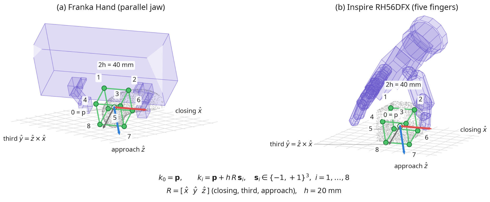
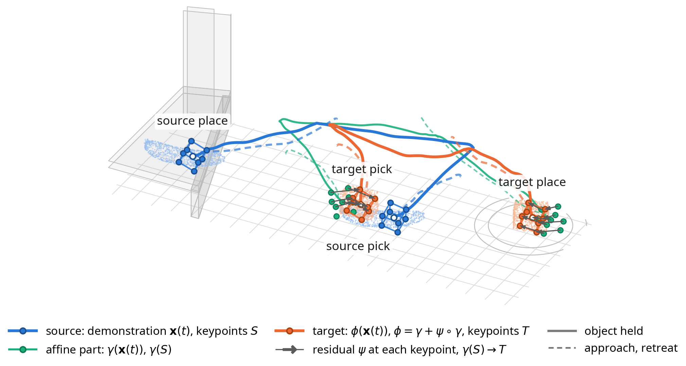

# Grasp-Anchored Task Parameterization for Cross-Embodiment and Cross-Object Geometric Transfer

**Transferring a demonstrated manipulation skill to new objects and robot hands without collecting a new task demonstration for each configuration.**

Geometric learning-from-demonstration methods can adapt a recorded movement to a new scene, but the original object–gripper interaction may no longer be suitable when the object or hand changes. We introduce **grasp-anchored task parameterization**, which constructs the geometric inputs to an existing adaptation method from an interaction suited to the **target object and gripper**.

This separates **how a robot hand engages an object** from **how the demonstrated task behavior is adapted**. It enables a skill to be transferred around a new grasp, approach, and placement while retaining the adaptation method itself.

Developed at the **HiRo Lab, Indian Institute of Science (IISc), Bengaluru**, under the guidance of **Prof. Ravi Prakash**.

**Code availability:** The implementation is currently private; a public code release is planned following publication.

## Real-Robot Transfer Examples

The source skill was taught once using a **banana and a Franka (Panda) parallel-jaw hand** for a reshelving task. The following clips show selected **executions of the adapted skill on a Franka FR3**, with different target objects, grippers, and destinations.

### Mug · Franka parallel-jaw hand · Top-left shelf

https://github.com/user-attachments/assets/572d25cb-3617-4f2e-a0ea-ba17eb37adc0

### Apple · Inspire five-finger hand · Top-right shelf

https://github.com/user-attachments/assets/ae289a85-7b0c-4107-a9a2-3f744bdc13b3

### Foam brick · Inspire five-finger hand · Plate

https://github.com/user-attachments/assets/5e3c3a00-107a-40aa-ab74-83b86a9bb569

## Method

A geometric adaptation method requires task geometry—such as reference frames or corresponding spatial keypoints—to transform demonstrated behavior. Instead of inheriting this geometry from the original grasp, our framework reconstructs it around an interaction suitable for the target object–gripper combination.

1. **Generate candidate grasps.** Use GraspGen-X to propose target grasps conditioned on the object and hand.
2. **Select a feasible interaction.** Screen candidates for grasp compatibility, robot reachability, scene collisions, and feasibility of the resulting adapted motion.
3. **Parameterize the task.** Derive the target pick interaction from the selected grasp and the release interaction from the desired object placement.
4. **Adapt the skill.** Express these interactions in the geometric representation expected by the existing method, without changing its adaptation procedure.

### Grasp-anchored keypoints

For policy transportation, each pick or release interaction is represented by a grasp center and eight vertices of a grasp-aligned cube with a fixed **20 mm half-extent**. The source and target pick–release interactions provide **18 corresponding keypoints** used to construct the transportation map. Other geometric methods can use their own task representations within the same grasp-anchoring principle.

*The same grasp-centered keypoint representation for a parallel-jaw gripper and a five-fingered hand.*

### Motion adaptation

The source and target interactions define spatial correspondences that guide the adaptation of the recorded Cartesian motion. In the transportation-map implementation, a rigid alignment and a smooth residual deformation map the demonstrated movement onto the target grasp and placement configuration.

*Source motion, rigid alignment, and nonlinear residual correction in the transported trajectory.*

## Evaluation

We evaluated grasp-anchored transfer with **policy transportation** on a reshelving task, starting from a **single kinesthetically taught banana demonstration**. The closed-loop **MuJoCo simulation** benchmark covered eight objects, ten robotic hands, and three target destinations for each combination.

| Measure | Result |
|---|---:|
| Object–hand combinations | 8 × 10 |
| Destinations per combination | 3 |
| Total closed-loop simulation trials | 240 |
| Feasible plans | 229 / 240 (95.4%) |
| **Successful placements** | **214 / 240 (89.2%)** |

A trial was successful if the object remained grasped until release and, after retreat, its centroid was within **30 mm** of the intended placement and its tilt differed by less than **30°** from the initial orientation. Planning refusals were counted as failures.

**Objects:** Apple, banana, mug, pudding box, foam brick, sugar box, potted meat can, and padlock.

**Hands:** Franka, Inspire, Robotiq 2F-85, Robotiq 2F-140, xArm, Rethink, Robotiq 3F, YuMi, Barrett, and Sharpa.

## Related Work and Attribution

The grasp-anchored task parameterization and its integration with feasibility-guided interaction selection are developed in this project. The method builds on the following research:

- **Policy Transportation:** G. Franzese, R. Prakash, C. Della Santina, and J. Kober, *Generalizable Motion Policies through Keypoint Parameterization and Transportation Maps*, IEEE Transactions on Robotics, 2025. [Project and implementation](https://github.com/franzesegiovanni/policy_transportation).
- **GraspGen-X:** B. Han *et al.*, *GraspGen-X: Cross-Embodiment 6-DOF Diffusion-based Grasping*, CVPR 2026. [Paper](https://openaccess.thecvf.com/content/CVPR2026/html/Han_GraspGen-X_Cross-Embodiment_6-DOF_Diffusion-based_Grasping_CVPR_2026_paper.html) · [Implementation](https://github.com/NVlabs/GraspGenX).
- **Elastic Motion Policy (EMP):** T. Li, S. Sun, S. S. Aditya, and N. Figueroa, *Elastic Motion Policy: An Adaptive Dynamical System for Robust and Efficient One-Shot Imitation Learning*, IROS 2025. [Project](https://elastic-motion-policy.github.io/EMP/).
